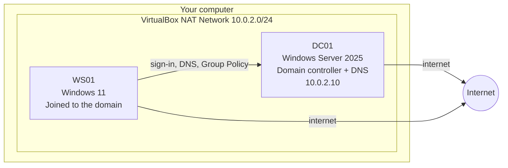

# Foundation Lab: Active Directory Home Lab

**Status:** ⚪ Planned. The beginner guide below is ready to work through; replace each section with your results and screenshots as you go.

**Goal:** Build a small company network at home: a domain controller, a Windows 11 workstation joined to the domain, users organized the way a real company does, and Group Policy controlling their computers. Then work through the help desk tickets that come up every day: password resets, lockouts, access requests, new hires and leavers.

**Company:** Contoso Maritime (fictional, the same company and users as the cloud projects) · **Tools:** VirtualBox, Windows Server 2025, Windows 11, Active Directory, Group Policy, PowerShell · **Cost:** $0

**Time:** about 2–3 evenings for parts 1–5, then one evening for the help desk tickets.

---

## What you're building



**Key words, explained once:**

| Term | Plain English |
|---|---|
| **Virtual machine (VM)** | A computer running inside your computer. You can break it and restore it in seconds. |
| **Active Directory (AD)** | The company phone book and security guard. It stores every user, computer and group, and checks passwords at sign-in. |
| **Domain** | The company's AD "world", here `contosomaritime.local`. Computers that join it trust AD for sign-ins. |
| **Domain controller (DC)** | The server that runs AD. |
| **OU (Organizational Unit)** | A folder inside AD for organizing users and computers, e.g. by department. |
| **Security group** | A list of users you give access to. Give access to the group, never to individual users. |
| **Group Policy (GPO)** | Rules AD pushes to computers and users, e.g. "lock the account after 5 wrong passwords". |
| **DNS** | Turns names into addresses. **Most AD problems are DNS problems.** |

---

## Part 0: Check your computer

| Need | Minimum | Better |
|---|---|---|
| RAM | 8 GB | 16 GB |
| Free disk space | 80 GB | 120 GB |
| Processor | 64-bit Intel or AMD with virtualization turned on | 4+ cores |

**Which computer do you have?**

- **Windows PC or Intel Mac** → follow this guide as written with VirtualBox.
- **Apple Silicon Mac (M1/M2/M3/M4)** → VirtualBox can't run Windows Server on these chips. Use **Azure VMs** instead (see [Appendix A](#appendix-a-running-the-lab-in-azure-apple-silicon-macs)), or borrow an older Windows PC.

**Is virtualization turned on? (Windows PC)**
1. Press `Ctrl + Shift + Esc` to open Task Manager.
2. Click **Performance** → **CPU**.
3. Look for **Virtualization: Enabled**. If it says Disabled, restart, enter the BIOS (usually `F2`, `F10` or `Del` at startup) and turn on **Intel VT-x** or **AMD-V / SVM**.

---

## Part 1: Download everything (≈1 hour, mostly waiting)

| Download | Where | Notes |
|---|---|---|
| **VirtualBox** | virtualbox.org → Downloads | Pick the version for your computer. Install with the defaults. |
| **Windows Server 2025 Evaluation** (ISO) | Microsoft Evaluation Center (search "Windows Server 2025 evaluation") | Free for 180 days. Choose **ISO**, **English (United States)**. Microsoft asks for your name and email. |
| **Windows 11 Enterprise Evaluation** (ISO) | Microsoft Evaluation Center (search "Windows 11 Enterprise evaluation") | Free for 90 days. Must be **Enterprise**: Windows 11 **Home** can't join a domain. |

Make a folder like `C:\Lab\ISOs` and save both ISOs there.

---

## Part 2: Set up the virtual network (5 minutes)

A **NAT Network** lets your two VMs talk to each other *and* reach the internet, while keeping them separate from your home network.

1. Open VirtualBox → **File** → **Tools** → **Network Manager**.
2. Click the **NAT Networks** tab → **Create**.
3. Set **Name:** `ContosoLab`, **IPv4 Prefix:** `10.0.2.0/24`, and tick **Enable DHCP**.
4. Click **Apply**.

📸 Screenshot: the NAT network settings.

---

## Part 3: Build the domain controller (≈1.5 hours)

### 3.1 Create the VM

1. In VirtualBox click **New**.
2. **Name:** `DC01` · **ISO Image:** your Windows Server 2025 ISO.
3. Tick **Skip Unattended Installation**. You'll install by hand so you see each step.
4. **Hardware:** 4096 MB memory (2048 if you only have 8 GB total), 2 processors.
5. **Hard disk:** 60 GB.
6. Click **Finish**.
7. Select DC01 → **Settings** → **Network** → Adapter 1 → **Attached to:** `NAT Network`, **Name:** `ContosoLab`. Click **OK**.

### 3.2 Install Windows Server

1. Select DC01 → **Start**. Click into the window and press any key when asked to boot from the CD.
2. Language: defaults → **Next** → **Install now**.
3. Choose **Windows Server 2025 Standard Evaluation (Desktop Experience)**.
   > ⚠️ **"Desktop Experience" matters.** Without it you get a black command-prompt screen with no Start menu.
4. Accept the licence → **Custom: Install Windows only** → select the disk → **Next**. Wait 10–20 minutes.
5. Set a strong **Administrator** password and write it down somewhere safe.
6. To sign in, use the VirtualBox menu **Input** → **Keyboard** → **Insert Ctrl-Alt-Del** (pressing it on your real keyboard goes to your own computer).

**Make the window resizable:** VirtualBox menu **Devices** → **Insert Guest Additions CD image**, open File Explorer → the CD drive → run `VBoxWindowsAdditions.exe` → install → restart.

### 3.3 Take a snapshot

VirtualBox → DC01 → the menu icon beside the VM name → **Snapshots** → **Take** → name it `Fresh install`.

> 💡 Take a snapshot **before every big step**. If something breaks, restore the snapshot and try again. This is how you learn without fear.

### 3.4 Give the server a name and a fixed address

A domain controller needs an address that never changes, because every computer looks for it there.

1. Right-click **Start** → **System** → **Rename this PC** → `DC01` → restart.
2. Right-click **Start** → **Network Connections** → **Change adapter options** → right-click **Ethernet** → **Properties**.
3. Double-click **Internet Protocol Version 4 (TCP/IPv4)** and set:

| Field | Value |
|---|---|
| IP address | `10.0.2.10` |
| Subnet mask | `255.255.255.0` |
| Default gateway | `10.0.2.1` |
| Preferred DNS server | `127.0.0.1` (itself, since it will run DNS) |
| Alternate DNS server | `8.8.8.8` (only until AD is installed) |

4. **OK** → **Close**. Open Edge and check a website still loads.

### 3.5 Install Active Directory

1. **Server Manager** opens automatically (or find it in Start).
2. **Manage** → **Add Roles and Features** → **Next** until **Server Roles**.
3. Tick **Active Directory Domain Services** → **Add Features** → **Next** through to **Install**.
4. When it finishes, click the **yellow flag ⚠️** at the top of Server Manager → **Promote this server to a domain controller**.
5. Choose **Add a new forest**, **Root domain name:** `contosomaritime.local`.
6. Set a **DSRM password** (an emergency recovery password; write it down).
7. Click **Next** through the rest (the DNS delegation warning is normal in a lab) → **Install**.
8. The server restarts. Sign in as **CONTOSOMARITIME\Administrator** (`CONTOSOMARITIME` is the short "NetBIOS" name of the domain).

> 💡 Real companies use a subdomain they own (e.g. `ad.contosomaritime.com`) instead of `.local`. `.local` is fine for a lab; the hybrid project later shows how to deal with it.

9. Go back to the IPv4 settings and **remove** the `8.8.8.8` alternate DNS. A DC should only use itself for DNS.

**Check it worked:** Start → **Windows Tools** → **Active Directory Users and Computers** (ADUC). You should see `contosomaritime.local` on the left.

📸 Screenshots: Server Manager showing AD DS installed, ADUC showing the domain.

**Snapshot:** `AD installed`.

---

## Part 4: Organize the company (≈1 hour)

### 4.1 Create OUs

In ADUC, right-click `contosomaritime.local` → **New** → **Organizational Unit**. Build this:

```
contosomaritime.local
└── Contoso
    ├── Users
    │   ├── IT
    │   ├── Engineering
    │   └── Compliance
    ├── Admins
    ├── Groups
    ├── Computers
    │   └── Workstations
    ├── Servers
    └── Disabled Users
```

Why a separate **Contoso** OU? The built-in `Users` and `Computers` folders can't have Group Policy linked to them. Your own OUs can.

### 4.2 Create the users

Right-click the right OU → **New** → **User**. Use the same people as the cloud projects:

| Name | Logon name | OU | Job title (Properties → Organization tab) |
|---|---|---|---|
| John Smith | `jsmith` | Users\IT | Platform Engineer |
| Tom Nguyen | `tnguyen` | Users\IT | IT Operations |
| Maria Lee | `mlee` | Users\Engineering | Developer |
| Ana Garcia | `agarcia` | Users\Compliance | Auditor |
| *Your name* | e.g. `pchery` | Users\IT | Help Desk Technician |
| *Your name* (admin) | e.g. `adm-pchery` | Admins | Help Desk Technician (admin account) |

For each one tick **User must change password at next logon**.

> 💡 **Why two accounts for you?** Real IT staff use a normal account for email and browsing and a separate admin account only for admin work. If the normal account is phished, the attacker doesn't get admin rights. This is the on-prem version of the "separate admin identity" in Project 1.

**Same thing with PowerShell** (try this after doing a couple by hand). Open **PowerShell as Administrator** on DC01:

```powershell
$ou = "OU=Engineering,OU=Users,OU=Contoso,DC=contosomaritime,DC=local"
New-ADUser -Name "Test User" -SamAccountName "tuser" -UserPrincipalName "tuser@contosomaritime.local" `
  -Path $ou -Title "Developer" -Department "Engineering" `
  -AccountPassword (Read-Host -AsSecureString "Password") -ChangePasswordAtLogon $true -Enabled $true
Get-ADUser tuser -Properties Title, Department
```

### 4.3 Create security groups

Right-click **Contoso\Groups** → **New** → **Group** (Group scope: **Global**, type: **Security**):

| Group | Members | Used for |
|---|---|---|
| `GRP-Engineering-Share-RW` | Maria Lee | Read/write on the Engineering file share |
| `GRP-Compliance-Share-R` | Ana Garcia | Read-only on the Compliance share |
| `GRP-HelpDesk` | Your admin account | Permission to reset passwords and unlock accounts |

The naming style matches the cloud projects: `GRP-<team>-<what>-<access>`.

### 4.4 Delegate help desk permissions (least privilege)

Your admin account should reset passwords, **not** be a Domain Admin.

1. Right-click **Contoso\Users** → **Delegate Control** → **Next**.
2. **Add** `GRP-HelpDesk` → **Next**.
3. Tick **Reset user passwords and force password change at next logon** → **Next** → **Finish**.

📸 Screenshots: OU tree, users in each OU, groups and members, the delegation wizard.

**Snapshot:** `Users and groups`.

---

## Part 5: Join a Windows 11 computer to the domain (≈1.5 hours)

### 5.1 Create the VM

1. VirtualBox → **New** → **Name:** `WS01`, **ISO:** Windows 11 Enterprise, tick **Skip Unattended Installation**.
2. 4096 MB memory, 2 processors, 64 GB disk.
3. **Settings** → **System**: make sure **Enable EFI** is ticked, and **TPM** is set to **v2.0** (Windows 11 requires it; it's under the Motherboard tab or Security section depending on version).
4. **Settings** → **Network** → **NAT Network** → `ContosoLab`.
5. Start it and install Windows 11. When asked to sign in with a Microsoft account, choose **Sign-in options** → **Domain join instead** to create a local account (e.g. `localadmin`).

### 5.2 Point it at the domain controller for DNS

This is the step most beginners miss. The workstation must ask **DC01** where the domain is.

1. **Settings** → **Network & internet** → **Ethernet** → **DNS server assignment** → **Edit** → **Manual** → turn on **IPv4**.
2. **Preferred DNS:** `10.0.2.10` → **Save**.
3. Open Command Prompt and run `nslookup contosomaritime.local`. It should answer with `10.0.2.10`.

### 5.3 Join the domain

1. **Settings** → **System** → **About** → **Domain or workgroup**, then click **Change** beside "To rename this computer or change its domain…".
2. **Computer name:** `WS01`, **Member of: Domain:** `contosomaritime.local` → **OK**.
3. Enter your **domain admin** credentials when asked → "Welcome to the contosomaritime.local domain" → restart.
4. On the sign-in screen choose **Other user** and sign in as `CONTOSOMARITIME\mlee`. Set her new password.

### 5.4 Tidy up

On DC01, in ADUC, find **WS01** in the built-in **Computers** folder and drag it to **Contoso\Computers\Workstations**.

📸 Screenshots: the join success message, Maria signed in to WS01 (run `whoami` in Command Prompt), WS01 in the Workstations OU.

**Snapshot both VMs:** `Domain joined`.

---

## Part 6: Group Policy (≈1 hour)

Open **Group Policy Management** on DC01 (Start → Windows Tools).

### GPO 1: Account lockout (security)

1. Right-click **Default Domain Policy** → **Edit**.
2. **Computer Configuration** → **Policies** → **Windows Settings** → **Security Settings** → **Account Policies** → **Account Lockout Policy**.
3. Set **Account lockout threshold:** `5` invalid attempts. Accept the suggested 15-minute values.

### GPO 2: File share with a mapped drive

1. On DC01 create `C:\Shares\Engineering` (in real life this would be a separate file server).
2. Right-click → **Properties** → **Sharing** → **Advanced Sharing** → share as `Engineering`. Under **Permissions** give **Authenticated Users** Full Control (the share is the outer door).
3. **Security** tab → **Edit** → add `GRP-Engineering-Share-RW` with **Modify**, and remove **Users** (NTFS permissions are the inner door, and the stricter of the two wins).
4. In Group Policy Management right-click **Contoso\Users\Engineering** → **Create a GPO in this domain, and Link it here** → name `GPO-Engineering-DriveMap`.
5. Edit it → **User Configuration** → **Preferences** → **Windows Settings** → **Drive Maps** → **New** → **Mapped Drive**:
   **Location:** `\\DC01\Engineering`, **Drive letter:** `E:`, **Label:** `Engineering`.

### GPO 3: Lock down standard users

1. Create and link `GPO-Users-Restrictions` on **Contoso\Users**.
2. **User Configuration** → **Policies** → **Administrative Templates** → **Control Panel** → **Prohibit access to Control Panel and PC settings** → **Enabled**.

### Test it

On WS01 signed in as Maria:
```cmd
gpupdate /force
gpresult /r
```
`gpresult` lists which GPOs applied. Maria should have an **E:** drive and no Control Panel.

📸 Screenshots: the three GPOs linked in Group Policy Management, `gpresult /r` output, Maria's E: drive, the Control Panel blocked message.

**Snapshot both VMs:** `Group Policy`.

---

## Part 7: Help desk tickets

Work each one like a real ticket: **symptom → investigate → fix → verify → document**. Do them signed in with your **admin account** (`adm-…`), not Domain Admin, so you prove the delegation works. These become your ServiceNow tickets in the next lab.

### Ticket 1: Forgotten password
**Symptom:** Ana can't remember her password.
1. ADUC → find Ana → right-click → **Reset Password**.
2. Tick **User must change password at next logon**.
3. **Verify:** Ana signs in to WS01 and is forced to choose a new password.

> 🔒 In real life, **verify the caller's identity first** (callback to a known number, manager confirmation). Help desk password resets are a favourite attack route.

### Ticket 2: Account locked out
**Symptom:** Tom typed the wrong password too many times.
1. On WS01, sign in as Tom with the wrong password 5 times. You'll see "account locked".
2. On DC01: **Event Viewer** → **Windows Logs** → **Security** → **Filter Current Log** → Event ID `4740`. It shows which account was locked and from which computer.
3. ADUC → Tom → **Properties** → **Account** tab → tick **Unlock account**.
4. **Verify:** Tom signs in.

PowerShell way: `Search-ADAccount -LockedOut` then `Unlock-ADAccount tnguyen`.

### Ticket 3: "I can't open the shared folder"
**Symptom:** John needs the Engineering share.
1. Confirm the request is approved (by his manager or the data owner).
2. Add John to `GRP-Engineering-Share-RW`.
3. John tries `\\DC01\Engineering` and it **still fails**.
4. **Fix:** John signs out and back in.
5. **Verify:** access works.

**Lesson:** group membership is read at sign-in. Users must sign out and back in (or restart) before a new group applies. This is one of the most common help desk tickets.

### Ticket 4: "My mapped drive is missing"
**Symptom:** John has access now but no E: drive.
1. On WS01 as John: `gpresult /r`. `GPO-Engineering-DriveMap` is **not** in the list.
2. **Why:** the GPO is linked to the Engineering OU, and John's account is in the IT OU.
3. **Fix options:** move the drive map to a GPO linked on **Contoso\Users** and use **item-level targeting** for `GRP-Engineering-Share-RW`, or accept that drive maps follow department.
4. **Verify:** `gpupdate /force`, sign out and in, E: appears.

### Ticket 5: New hire (joiner)
**Symptom:** HR says Sam Rivera starts Monday as a Developer.
1. Create the user in **Users\Engineering** with title and department filled in.
2. Add to `GRP-Engineering-Share-RW`.
3. Set **User must change password at next logon**.
4. **Verify:** Sam signs in to WS01 and gets the E: drive.

### Ticket 6: Department change (mover)
**Symptom:** Maria moves from Engineering to Compliance.
1. Move her user object to **Users\Compliance** and update her job title and department.
2. **Remove** her from `GRP-Engineering-Share-RW`, **add** her to `GRP-Compliance-Share-R`.
3. **Verify:** after signing in again, she has no Engineering access.

**Lesson:** the classic mistake is adding new access but forgetting to remove the old. Over time this builds **privilege creep**. Access Reviews in Project 2 exist to catch it.

### Ticket 7: Employee leaves (leaver)
**Symptom:** Ana's last day is today.
1. **Disable** the account (right-click → Disable Account). Don't delete it straight away: disabled accounts keep their history and can be re-enabled if needed.
2. Reset the password to something random.
3. Remove her from all groups except Domain Users.
4. Move her to **Disabled Users** and add a note in **Description**, e.g. `Disabled 2026-11-03 – leaver, ticket INC0001`.
5. **Verify:** she can't sign in to WS01.

📸 For each ticket: the before state, the fix, and the after state.

---

## Troubleshooting

| Problem | Likely cause | Fix |
|---|---|---|
| "An Active Directory Domain Controller could not be contacted" when joining | WS01's DNS isn't pointing at DC01 | Set WS01 DNS to `10.0.2.10`; check `nslookup contosomaritime.local` |
| VM has no internet | Not on the NAT Network, or wrong gateway | Adapter → NAT Network `ContosoLab`; DC gateway `10.0.2.1` |
| Windows 11: "This PC can't run Windows 11" | No TPM / EFI | VM settings: enable EFI and TPM 2.0 |
| GPO not applying | Linked to the wrong OU, or user in the wrong OU | `gpresult /r`, then check where the GPO is linked and where the user is |
| New group access not working | Old sign-in token | Sign out and back in |
| VM is very slow | Not enough RAM | Close other apps; give DC01 2 GB and WS01 4 GB |
| Evaluation expired | 180 / 90 day limit | Rebuild from your notes; it's faster the second time |

---

## Appendix A: Running the lab in Azure (Apple Silicon Macs)

You can build the same lab with Azure VMs instead of VirtualBox. **This costs money while VMs are running**, so:

1. In the Azure portal create a **resource group** `rg-adlab` and a **virtual network** `10.0.2.0/24`.
2. Create two VMs in that network: `DC01` (Windows Server 2025 Datacenter, size **B2s**) and `WS01` (Windows 11 Enterprise, **B2s**).
3. On each VM turn on **Auto-shutdown** (e.g. 11 PM) and **stop (deallocate)** them when you finish each session. A stopped-but-not-deallocated VM still charges.
4. Give DC01 a static private IP `10.0.2.10` in its network interface settings, and set the **virtual network's DNS servers** to `10.0.2.10` after AD is installed.
5. Connect with **Remote Desktop** (Windows App on Mac). Restrict RDP to your own IP address, or use Azure Bastion.
6. Set a **budget alert** in Cost Management (e.g. $10) so you're warned early.
7. When the lab is done, delete `rg-adlab` to stop all charges.

Your Azure Policy from Project 1 still applies if the subscription is under Corp: use **East US**, add a `CostCenter` tag to the resource group, and don't create public IPs there. Put the lab in a Sandbox subscription, or use Bastion instead of public IPs.

---

## Zero Trust and least privilege, on-prem

| Principle | How |
|---|---|
| Verify explicitly | Identity checks before password resets; account lockout stops password guessing |
| Least privilege | Delegated password-reset rights instead of Domain Admin; access through groups; mover access removed |
| Assume breach | Separate admin account; leavers disabled the same day; event ID 4740 used to trace lockouts |

## Lessons learned

_Fill in as you go: what broke, how you fixed it, what surprised you._

## Resume bullet (update once complete)

> Built an Active Directory home lab (Windows Server 2025, Windows 11) with a departmental OU structure, group-based file share access, delegated help desk permissions and Group Policy for account lockout, drive mapping and desktop restrictions; resolved common help desk tickets including lockouts, password resets, access requests and joiner/mover/leaver changes using ADUC, Event Viewer and PowerShell.

## Interview prep

1. A user can't sign in. What do you check first, and in what order?
2. What's the difference between an OU and a security group?
3. A user was added to a group but still can't access the share. Why?
4. Why shouldn't help desk staff be Domain Admins?
5. A GPO isn't applying to a user. How do you troubleshoot it?
6. What's the difference between share permissions and NTFS permissions?
7. Why disable a leaver's account instead of deleting it?
8. What does event ID 4740 tell you?
