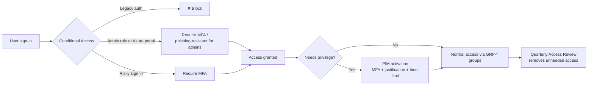

# Project 2: Enterprise IAM

**Status:** ⚪ Planned. The lab guide below is ready to work through; replace each section with results and screenshots as it's completed.

**Goal:** Remove standing admin access and make every sign-in earn its access. Privileged roles become just-in-time through PIM, Conditional Access decides who gets in and under what conditions, MFA is enforced with strong methods, and Access Reviews clean up access nobody needs any more. Then prove every control works with the Project 1 test accounts.

**Company:** Contoso Maritime (fictional) · **Tools:** Microsoft Entra ID P2, Privileged Identity Management, Conditional Access, Authentication methods, Access Reviews · **Builds on:** [Project 1](../Project1-landing-zone/)

---

## Architecture

---

## 0. Prerequisites and safety

| Item | Why |
|---|---|
| **Entra ID P2 licence** | PIM, Access Reviews and risk-based Conditional Access need P2. Start a free trial in the Entra admin center (Billing → Licenses → All products → Try / Buy). Trials are time-limited, so start it when you can work through all the sections. |
| Assign P2 to the test users | John, Maria, Ana, Tom and your admin account |
| **Break-glass account excluded from every CA policy** | If a policy locks everyone out, this account gets you back in. Check it can sign in before turning anything on. |
| Policies start in **Report-only** | See the impact in the sign-in logs before enforcing |
| Turn off **Security defaults** only when your CA MFA policies are ready | Security defaults and Conditional Access can't both be on |

> Portal menu names change from time to time. Paths below are from the Microsoft Entra admin center (entra.microsoft.com).

---

## 1. Privileged Identity Management (PIM)

Path: **ID Governance → Privileged Identity Management**

### 1a. Entra role: just-in-time User Administrator

| Setting | Value |
|---|---|
| Role | User Administrator |
| Eligible | John Smith |
| Max activation | 2 hours |
| On activation | Require MFA, justification, **approval** (approver: your admin account) |
| Notifications | Email the approver and admin on activation |

### 1b. Azure resource: just-in-time Contributor on Platform

Project 1 gave GRP-Platform-Admins **standing** Contributor on the Platform management group. Convert it:

1. PIM → Azure resources → select the **Platform** management group.
2. Add an **eligible** Contributor assignment for GRP-Platform-Admins.
3. Remove the old **active** Contributor assignment.
4. Role settings: max 4 hours, require MFA and justification.

### Tests

| Test | Expected |
|---|---|
| John creates a resource group under Platform **before** activating | ❌ `AuthorizationFailed` |
| John activates Contributor with a justification | ✅ Active for 4 hours |
| John creates the resource group again | ✅ Created |
| John requests User Administrator | ⏳ Pending until approved |
| Approver approves, John resets Tom's password | ✅ Works; appears in PIM audit history |

📸 Screenshots: eligible assignments, role settings, activation request, approval, `AuthorizationFailed` before activation, PIM audit history.

---

## 2. Authentication methods and MFA

Path: **Protection → Authentication methods**

| Method | Setting |
|---|---|
| Microsoft Authenticator | Enabled for all users, number matching and app/location context shown |
| Passkeys (FIDO2) | Enabled for admins, so admins can use phishing-resistant MFA |
| SMS / voice call | Disabled for admins (weakest methods) |
| Registration campaign | Nudge users without Authenticator to register |

Also create an **authentication strength** called *Admin phishing-resistant* (passkey / Windows Hello for Business) for policy CA003 below.

📸 Screenshots: methods policy, authentication strength, a user's registered methods.

---

## 3. Conditional Access

Path: **Protection → Conditional Access → Policies**. Naming convention: `CA<number>-<who>-<what>-<control>`.

| Policy | Users | Target | Conditions | Grant |
|---|---|---|---|---|
| CA001-All-LegacyAuth-Block | All users | All resources | Client apps: Exchange ActiveSync, other clients | Block |
| CA002-All-AzureMgmt-MFA | All users | Windows Azure Service Management API | – | Require MFA |
| CA003-Admins-AllApps-PhishResistant | Directory roles (Global Admin, User Admin, Privileged Role Admin…) | All resources | – | Authentication strength: *Admin phishing-resistant* |
| CA004-All-AllApps-MediumRisk-MFA | All users | All resources | Sign-in risk: medium and high | Require MFA |
| CA005-All-AllApps-BlockedCountries | All users | All resources | Locations: all except named location *Allowed countries* (US) | Block |

**Every policy excludes the break-glass account.**

Rollout:
1. Create all five in **Report-only**.
2. Sign in as each test user, then check the sign-in logs → **Report-only** tab for each policy's result.
3. Use the **What If** tool to test cases you can't reproduce (another country, legacy client).
4. Switch policies to **On** one at a time, then turn off Security defaults.

### Tests

| Test | Expected |
|---|---|
| Maria signs in to the Azure portal | ✅ Prompted for MFA (CA002) |
| What If: Maria, from a country outside the named location | ❌ Blocked by CA005 |
| What If: Maria, legacy client (Exchange ActiveSync) | ❌ Blocked by CA001 |
| John activates User Administrator in PIM, then signs in | ✅ Prompted for a passkey (CA003) |
| Break-glass account signs in | ✅ No CA policy applies |
| Sign-in log for a blocked attempt | Shows the policy name and failure reason |

📸 Screenshots: policy list, each policy's settings, report-only results, What If results, sign-in log entries.

---

## 4. Access Reviews

Path: **ID Governance → Access reviews**

| Setting | Value |
|---|---|
| Review | Members of GRP-Corp-Contributors |
| Reviewer | Ana Garcia (Auditor), a realistic separation of duties |
| Frequency | Quarterly (run once now for the lab) |
| If reviewer doesn't respond | Remove access |
| Auto-apply results | On |

Second review: **PIM eligible assignments** for the Contributor role on Platform (reviewer: your admin account).

### Tests

| Test | Expected |
|---|---|
| Ana opens the review at myaccess.microsoft.com | Sees Maria Lee, with sign-in activity |
| Ana denies Maria with a reason | Recorded in review history |
| Review completes and results apply | Maria removed from GRP-Corp-Contributors |
| Maria tries to create a resource group in Corp | ❌ `AuthorizationFailed`; access removed end to end |
| Re-add Maria to the group | Restores lab state |

📸 Screenshots: review settings, Ana's review screen, results, Maria denied.

---

## 5. Cleanup

- Leave CA policies **On**. They protect the tenant even after the lab.
- Before the P2 trial ends, note which features stop working (PIM activations, risk policies, Access Reviews) and record it in Lessons learned.
- Confirm no account still has standing Global Administrator besides the break-glass account.

---

## Zero Trust principles applied

| Principle | How |
|---|---|
| Verify explicitly | Conditional Access evaluates every sign-in; MFA for Azure management, phishing-resistant MFA for admins, risk-based step-up |
| Least privilege | No standing admin roles; PIM gives time-limited, approved, audited access; Access Reviews remove what isn't needed |
| Assume breach | Legacy auth blocked, sign-ins from unexpected countries blocked, break-glass account kept for recovery |

## Lessons learned

_Fill in as you go. Things worth noting: anything that surprised you, errors and their fixes, and how long changes took to apply._

## Resume bullet (update once complete)

> Implemented Zero Trust identity controls in Microsoft Entra ID: just-in-time privileged access with PIM (approval, MFA, time-bound activation), five Conditional Access policies including phishing-resistant MFA for admins and risk-based step-up, and Access Reviews that automatically removed unneeded access; validated each control with test accounts, What If analysis and sign-in logs.

## Interview prep

Be ready to answer:
1. What's the difference between an **eligible** and an **active** assignment in PIM?
2. Why exclude a break-glass account from Conditional Access, and how do you protect it instead?
3. Why use **Report-only** before turning a policy on?
4. What's the difference between **sign-in risk** and **user risk**?
5. Why is Authenticator push with number matching stronger than SMS, and why is a passkey stronger still?
6. How do PIM and Access Reviews work together to enforce least privilege over time?
