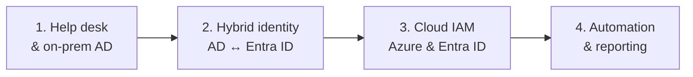

# IAM Home Lab: from Help Desk to Cloud Identity

Hands-on identity and access management (IAM) labs for a fictional company, **Contoso Maritime**. The labs follow a real career path: help desk and on-prem Active Directory first, then hybrid identity, then Azure and Microsoft Entra ID with Zero Trust controls. The same company and users appear throughout, with screenshots as evidence.

> Personal home lab built on my own time with personal accounts and equipment. All company names, users and data are fictional.

## Roadmap

### Phase 1: Help desk and on-prem identity

| Project | What it covers | Status |
|---------|----------------|--------|
| [Active Directory Home Lab](AD-home-lab/) | Domain controller, OUs, users and groups, delegated help desk rights, Group Policy, file share permissions, help desk tickets (lockouts, resets, joiner/mover/leaver) | ⚪ Planned (lab guide ready) |
| ServiceNow Ticketing | Incident and request workflows for the AD help desk tickets on a free developer instance | ⚪ Planned |

### Phase 2: Hybrid identity

| Project | What it covers | Status |
|---------|----------------|--------|
| Entra Connect Sync | Sync the on-prem AD users to Microsoft Entra ID | ⚪ Planned |

### Phase 3: Cloud IAM

| Project | What it covers | Status |
|---------|----------------|--------|
| [Project 1: Azure Landing Zone](Project1-landing-zone/) | Management group hierarchy (CAF), group-based RBAC, custom least-privilege role, Azure Policy guardrails. Also built [as code with Bicep](Project1-landing-zone/bicep/) | ✅ Complete |
| [Project 2: Enterprise IAM](Project2-enterprise-iam/) | Privileged Identity Management (PIM), Conditional Access, MFA, Access Reviews | ⚪ Planned (lab guide ready) |

### Phase 4: Automation and reporting

| Project | What it covers | Status |
|---------|----------------|--------|
| Project 3: Automated Onboarding | Joiner / mover / leaver workflows with Power Automate + Entra ID | ⚪ Planned |
| Project 4: RBAC Audit Dashboard | Power BI reporting on role assignments and access | ⚪ Planned |

## Zero Trust principles applied

- **Verify explicitly:** MFA with number matching on every privileged account
- **Least privilege:** access granted to groups, scoped to the lowest level needed, with custom roles where built-in roles give too much
- **Assume breach:** separate admin identities, a break-glass account, and guardrails that block risky actions before they happen

## Tools

Microsoft Azure · Microsoft Entra ID · Azure RBAC · Azure Policy · Bicep · Microsoft Graph PowerShell · GitHub Actions · Microsoft Authenticator · diagrams.net

## About me

Building toward IAM / Zero Trust roles. Connect with me on [LinkedIn](https://www.linkedin.com/in/patriquechery-cyber).
